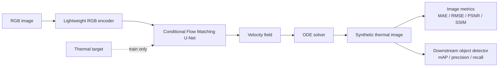
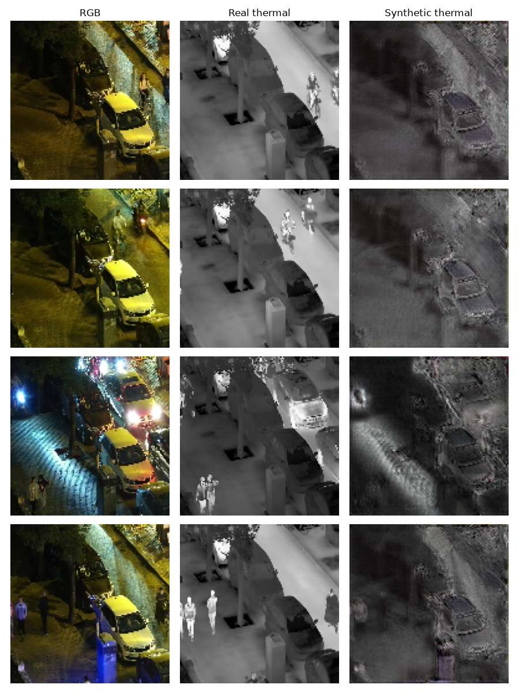
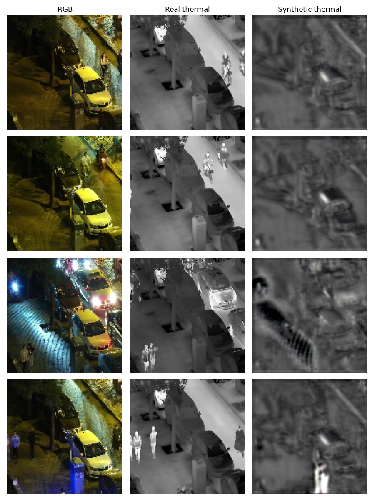

<div align="center">

# Thermal-Flow

**Few-shot RGB → Thermal domain adaptation with a lightweight conditional Flow Matching model.**

[](https://github.com/eljandoubi/Thermal-Flow/actions/workflows/ci.yml)
[](LICENSE)
[](pyproject.toml)
[](https://docs.astral.sh/uv/)
[](https://github.com/astral-sh/ruff)
[](https://wandb.ai/)

</div>

---

## Contents

- [Overview](#overview)
- [Pipeline](#pipeline)
- [Highlights](#highlights)
- [Quickstart](#quickstart)
- [Usage](#usage)
- [Study: few-shot RGB to thermal on LLVIP](#study-few-shot-rgb-to-thermal-on-llvip)
- [Configuration & experiment tracking](#configuration--experiment-tracking)
- [Hardware / device notes](#hardware--device-notes)
- [Project structure](#project-structure)
- [Development](#development)
- [Datasets](#datasets)
- [License](#license)

## Overview

Thermal cameras help autonomous-driving perception in conditions where RGB struggles (night,
low light, haze), but thermal datasets are scarce and expensive to collect. Thermal-Flow learns
to translate RGB images into synthetic thermal images using only a small number of paired
RGB-thermal examples, then evaluates the result both visually (MAE/RMSE/PSNR/SSIM) and
functionally (does it help a downstream object detector?).

> **Research question:** Can a lightweight conditional Flow Matching model learn a useful
> RGB-to-thermal mapping when only a small amount of paired thermal data is available?

## Pipeline



## Highlights

- **Lightweight by design.** A ~5-15M parameter conditional U-Net, benchmarked (params, size,
  FLOPs, images/sec) via [`evaluation.efficiency`](src/thermal_flow/evaluation/efficiency.py).
- **Few-shot native.** A deterministic, seeded subsampling protocol
  (10 / 50 / 100 / 500 / 1000 / Full) plus a parameter-efficient bottleneck adapter for
  cheap fine-tuning on a handful of thermal pairs.
- **Three baselines included.** CNN regression, U-Net and Pix2Pix, so Flow Matching is always
  evaluated against established alternatives, not in isolation.
- **Trustworthy evaluation.** Image-level metrics plus COCO-style downstream detection
  metrics (mAP@50, mAP@50:95, precision, recall) via `torchmetrics`.
- **Runs everywhere.** Device selection (CUDA, then Apple MPS, then CPU) is automatic.
  Developed on Apple Silicon, trains on an NVIDIA GPU with zero config changes (see below).
- **Reproducible tooling.** `uv`-managed environment, `ruff` lint/format, `pytest` (100+
  tests on synthetic fixtures, no real dataset required), GitHub Actions CI, and a `justfile`
  for one-command workflows.
- **Optional experiment tracking.** Plug in [Weights & Biases](https://wandb.ai/) with a
  single config flag. Fully disabled (and dependency-free at import time) by default.

## Quickstart

Requires [uv](https://docs.astral.sh/uv/) (manages the Python version and virtual environment
for you) and, optionally, [just](https://github.com/casey/just) (a friendly task runner).

```bash
# install dependencies (creates .venv, installs the pinned Python 3.11)
uv sync

# run everything CI runs: lint, format check, tests
just ci
# ...or without just:
uv run ruff check . && uv run ruff format --check . && uv run pytest
```

## Usage

Build the model and sample a synthetic thermal image from an RGB tensor:

```python
import torch
from thermal_flow.inference.sample import sample
from thermal_flow.models.flow_matching import ConditionalFlowMatching
from thermal_flow.models.unet import ConditionalUNet

model = ConditionalFlowMatching(ConditionalUNet())
x_rgb = torch.rand(1, 3, 256, 256)
synthetic_thermal = sample(model, x_rgb, num_steps=8)  # (1, 3, 256, 256)
```

Train on a few-shot subset from a YAML config:

```python
from thermal_flow.training.config import TrainingConfig
from thermal_flow.training.train_fewshot import run_fewshot_training

config = TrainingConfig.from_yaml("configs/fewshot.yaml")
model = run_fewshot_training(config)
```

## Study: few-shot RGB to thermal on LLVIP

`thermal-flow-study` trains the four methods on the same pairs, with the same number of optimizer steps, and scores them on the same test images, so Flow Matching is compared with the baselines and not on its own.

| method | what it is |
| --- | --- |
| `cnn` | plain convolutional regression, L1 loss |
| `unet` | U-Net regression, L1 loss |
| `pix2pix` | U-Net generator with a PatchGAN discriminator (least-squares GAN loss, L1 weight 100) |
| `flow_matching` | the conditional Flow Matching U-Net of this repository, 8 ODE steps at inference |

```bash
uv run thermal-flow-study --root data/llvip --sizes 10 100 1000 full \
  --methods cnn unet pix2pix flow_matching --steps 2000 --batch-size 16 \
  --image-size 128 --base-channels 64 --test-images 500 --seeds 0 \
  --output results/llvip_study
```

The pairs are drawn from the 12,025 LLVIP training pairs with the seeded subsampling of [`datasets.fewshot`](src/thermal_flow/datasets/fewshot.py). The test set is 500 evenly spaced pairs of the 3,463 LLVIP test pairs, at 128 x 128. The command writes `study.json` (one row per run), `study.md`, `efficiency.json`, a PSNR-versus-pairs curve per method and side-by-side grids; [`results/llvip_study/`](results/llvip_study/) keeps the tables and two grids.

### Results

One run per cell (seed 0), 2,000 optimizer steps of batch size 16, on one free Colab T4. MAE, RMSE and PSNR are on images scaled to [0, 1]; the last row group trains on all 12,025 pairs.

| method | pairs | MAE | RMSE | PSNR (dB) | SSIM |
| --- | --- | --- | --- | --- | --- |
| cnn | 10 | 0.1871 | 0.2316 | 12.76 | 0.227 |
| unet | 10 | 0.2019 | 0.2522 | 12.01 | 0.238 |
| pix2pix | 10 | 0.2058 | 0.2578 | 11.80 | 0.191 |
| flow_matching | 10 | 0.1905 | 0.2366 | 12.54 | 0.258 |
| cnn | 100 | 0.1633 | 0.2069 | 13.72 | 0.312 |
| unet | 100 | 0.1817 | 0.2297 | 12.79 | 0.273 |
| pix2pix | 100 | 0.1797 | 0.2298 | 12.79 | 0.245 |
| flow_matching | 100 | 0.1692 | 0.2119 | 13.49 | 0.296 |
| cnn | 1000 | 0.1656 | 0.2069 | 13.71 | 0.327 |
| unet | 1000 | 0.1683 | 0.2116 | 13.51 | 0.309 |
| pix2pix | 1000 | 0.1771 | 0.2256 | 12.95 | 0.242 |
| flow_matching | 1000 | 0.1677 | 0.2113 | 13.53 | 0.310 |
| cnn | 12,025 | 0.1644 | 0.2064 | 13.74 | 0.333 |
| unet | 12,025 | 0.1701 | 0.2168 | 13.30 | 0.302 |
| pix2pix | 12,025 | 0.1746 | 0.2213 | 13.11 | 0.272 |
| flow_matching | 12,025 | 0.1782 | 0.2259 | 12.97 | 0.315 |

- The plain CNN has the best PSNR at every training size and the best SSIM from 100 pairs on. Flow Matching has the best SSIM with 10 pairs, is second on both metrics with 100 and 1,000 pairs, and is last on PSNR with all pairs. Pix2Pix has the lowest SSIM at every size.
- The methods stay within 1 dB of each other at every size, from 11.8 to 13.7 dB. Going from 10 to 100 pairs helps by about 1 dB, and beyond 100 pairs more data changes PSNR by less than 1 dB and not always upward. With one seed per cell, differences of a few tenths of a dB should not be read as a ranking.
- The synthetic images keep the layout (cars, road edges) but not the intensities: in the grids below, the warm road and the people of the real thermal image come out dark with Flow Matching and blurred with the CNN.





The four test images of each grid are the first four of the test set, taken a few frames apart in one scene.

Cost of one forward pass at 128 x 128 on the T4 (batch size 1, [`efficiency.json`](results/llvip_study/efficiency.json)):

| method | parameters | size (MB) | GFLOPs | passes per second |
| --- | --- | --- | --- | --- |
| cnn | 77,379 | 0.30 | 2.5 | 1763 |
| unet | 1,862,979 | 7.11 | 12.7 | 435 |
| pix2pix (generator) | 1,862,979 | 7.11 | 12.7 | 334 |
| flow_matching (network) | 1,073,731 | 4.10 | 7.4 | 338 |

A Flow Matching sample needs 8 network passes, about 42 images per second. The study scores image metrics only (no downstream detector) and trains every method for 2,000 steps only, so the numbers describe that budget, not the best each method can do.

## Configuration & experiment tracking

Every training entry point (`training.train.run_training`, `training.train_fewshot`,
`training.finetune_adapter`) takes a single `TrainingConfig`, loadable from a YAML file
(see [`configs/`](configs/)) or a plain dict:

```yaml
dataset: { root: data/flir, image_size: 256 }
model: { base_channels: 96, time_dim: 128 }
few_shot: { num_samples: 100, seed: 0 }
wandb: { enabled: true, project: thermal-flow, mode: online }
batch_size: 8
num_epochs: 100
```

Set `wandb.enabled: true` (and run `just wandb-login` once) to log per-epoch loss curves and
the full run configuration to Weights & Biases; leave it `false` (the default) and training
never imports `wandb` at all.

## Hardware / device notes

This model is developed on macOS (CPU/MPS) but is meant to **train on an NVIDIA GPU on a separate
machine**. No special configuration is needed to get there:

- `uv.lock` is resolved for all platforms ("universal resolution"), so it already pins
  CUDA-capable Linux wheels for `torch` (with the matching `nvidia-*` runtime packages) alongside
  the macOS build. Running `uv sync` on the GPU machine installs the CUDA build automatically.
- All code selects its compute device through [`thermal_flow.device.get_device`](src/thermal_flow/device.py),
  which prefers CUDA, then Apple MPS, then CPU, so the same code runs unmodified on both machines.
- If the GPU machine's driver doesn't support the CUDA version bundled by default, pin a specific
  `pytorch-cuXXX` index per [uv's PyTorch guide](https://docs.astral.sh/uv/guides/integration/pytorch/);
  not required out of the box.

## Project structure

```
src/thermal_flow/
├── device.py             # compute device selection: cuda > mps > cpu
├── models/                # timestep embedding, conditional U-Net, flow matching, adapter
├── inference/             # Euler/RK4 ODE solvers, end-to-end sampling
├── losses/                # flow matching, SSIM, edge losses, combined objective
├── datasets/              # FLIR/LLVIP loaders, preprocessing, few-shot subsampling, data prep CLI
├── baselines/             # CNN, U-Net, Pix2Pix baselines
├── training/               # config schema, checkpointing, tracking, train/fewshot/adapter loops
├── evaluation/             # image metrics, efficiency, downstream detection
├── experiments/            # fewshot sweep, ablation runner, efficiency benchmarking
└── visualization/          # metric plots, qualitative comparison grids
configs/                   # example YAML training configs (flir/llvip/fewshot)
tests/                     # unit tests (flat, one file per module, synthetic data/fixtures only)
.github/workflows/ci.yml   # lint + format check + tests, on every push/PR
justfile                   # one-command dev workflows (just --list)
```

## Development

All commands below are also available as `just` recipes (`just --list`):

| Command                        | `just` recipe   | Description                          |
| ------------------------------ | ---------------- | ------------------------------------ |
| `uv sync`                       | `just sync`       | Install/refresh the environment      |
| `uv run pytest`                 | `just test`       | Run the test suite                   |
| `uv run ruff check .`           | `just lint`       | Lint                                 |
| `uv run ruff check --fix .`     | `just lint-fix`   | Lint, auto-fixing what it can        |
| `uv run ruff format .`          | `just format`     | Format                               |
| `uv run ruff format --check .`  | `just format-check` | Check formatting without changes   |
| -                               | `just ci`         | lint + format-check + test (= CI)    |
| `uv run wandb login`            | `just wandb-login`| One-time Weights & Biases login      |
| `uv run thermal-flow-data ...`  | `just data ...`   | Download/convert datasets (see below) |
| -                               | `just clean`      | Remove caches/coverage/build output  |

Continuous integration ([`.github/workflows/ci.yml`](.github/workflows/ci.yml)) runs the exact
same `just ci` steps on every push and pull request, across Python 3.11 and 3.12.

## Datasets

- **FLIR ADAS** (primary): paired RGB/thermal automotive imagery with object annotations.
- **LLVIP** (secondary): aligned visible/infrared pedestrian imagery, used to validate that the
  approach generalizes beyond one dataset.

Dataset loaders expect the normalized layout `root/<split>/{rgb,thermal}/<name>.ext` and are
unit-tested against small synthetic fixtures, so the test suite never needs the real datasets.
The `thermal-flow-data` command (`uv sync --extra data`, then `just data <command>` or
`uv run thermal-flow-data <command>`) converts each raw download into that layout.

**LLVIP** is a single archive shared directly from the dataset's own Google Drive, no
registration required:

```bash
just data download-llvip --output data/llvip_raw
just data convert-llvip --source data/llvip_raw/LLVIP.zip --output data/llvip
```

Google Drive limits downloads of popular files ("Too many users have viewed or downloaded this
file recently"). When that happens, the 4.0 GB archive is also mirrored on the Hugging Face hub,
and `convert-llvip` reads it the same way:

```bash
curl -L --create-dirs -o data/llvip_raw/LLVIP.zip \
  https://huggingface.co/datasets/jsonhash/LLVIP/resolve/main/LLVIP.zip
just data convert-llvip --source data/llvip_raw/LLVIP.zip --output data/llvip
```

**FLIR ADAS** requires registering on the vendor's site to get a download link. Once it is
extracted, reorganize it the same way; its folder names have varied across releases, so use
`--dry-run` first and override `--rgb-dirname`/`--thermal-dirname`/`--splits` if it reports no
matches:

```bash
just data convert-flir --source path/to/extracted/flir --output data/flir --dry-run
just data convert-flir --source path/to/extracted/flir --output data/flir
```

Object detection evaluation is detector-agnostic: `evaluate_detector` accepts any
torchvision-style detector, so no pretrained weights are bundled.

## License

Apache License 2.0. See [LICENSE](LICENSE).

