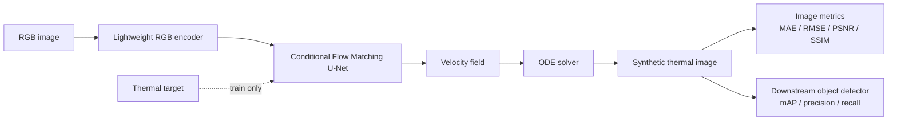

<div align="center">

# Thermal-Flow

**Few-shot RGB → Thermal domain adaptation with a lightweight conditional Flow Matching model.**

[](https://github.com/eljandoubi/Thermal-Flow/actions/workflows/ci.yml)
[](LICENSE)
[](pyproject.toml)
[](https://docs.astral.sh/uv/)
[](https://github.com/astral-sh/ruff)
[](https://wandb.ai/)

</div>

---

## Contents

- [Overview](#overview)
- [Pipeline](#pipeline)
- [Highlights](#highlights)
- [Quickstart](#quickstart)
- [Usage](#usage)
- [Configuration & experiment tracking](#configuration--experiment-tracking)
- [Hardware / device notes](#hardware--device-notes)
- [Project structure](#project-structure)
- [Development](#development)
- [Project status](#project-status)
- [Datasets](#datasets)
- [License](#license)

## Overview

Thermal cameras help autonomous-driving perception in conditions where RGB struggles (night,
low light, haze), but thermal datasets are scarce and expensive to collect. Thermal-Flow learns
to translate RGB images into synthetic thermal images using only a small number of paired
RGB-thermal examples, then evaluates the result both visually (MAE/RMSE/PSNR/SSIM) and
functionally (does it help a downstream object detector?).

> **Research question:** Can a lightweight conditional Flow Matching model learn a useful
> RGB-to-thermal mapping when only a small amount of paired thermal data is available?

The full research proposal (motivation, architecture, training pipeline, ablations, evaluation
plan) lives in `tmp/` locally and is intentionally not tracked in git.

## Pipeline



## Highlights

- **Lightweight by design** — a ~5-15M parameter conditional U-Net, benchmarked (params, size,
  FLOPs, images/sec) via [`evaluation.efficiency`](src/thermal_flow/evaluation/efficiency.py).
- **Few-shot native** — a deterministic, seeded subsampling protocol
  (10 / 50 / 100 / 500 / 1000 / Full) plus a parameter-efficient bottleneck adapter for
  cheap fine-tuning on a handful of thermal pairs.
- **Three baselines included** — CNN regression, U-Net and Pix2Pix, so Flow Matching is always
  evaluated against established alternatives, not in isolation.
- **Trustworthy evaluation** — image-level metrics plus COCO-style downstream detection
  metrics (mAP@50, mAP@50:95, precision, recall) via `torchmetrics`.
- **Runs everywhere** — device selection (CUDA → MPS → CPU) is automatic; developed on
  Apple Silicon, trains on an NVIDIA GPU with zero config changes (see below).
- **Reproducible tooling** — `uv`-managed environment, `ruff` lint/format, `pytest` (100+
  tests on synthetic fixtures, no real dataset required), GitHub Actions CI, and a `justfile`
  for one-command workflows.
- **Optional experiment tracking** — plug in [Weights & Biases](https://wandb.ai/) with a
  single config flag; fully disabled (and dependency-free at import time) by default.

## Quickstart

Requires [uv](https://docs.astral.sh/uv/) (manages the Python version and virtual environment
for you) and, optionally, [just](https://github.com/casey/just) (a friendly task runner).

```bash
# install dependencies (creates .venv, installs the pinned Python 3.11)
uv sync

# run everything CI runs: lint, format check, tests
just ci
# ...or without just:
uv run ruff check . && uv run ruff format --check . && uv run pytest
```

## Usage

Build the model and sample a synthetic thermal image from an RGB tensor:

```python
import torch
from thermal_flow.inference.sample import sample
from thermal_flow.models.flow_matching import ConditionalFlowMatching
from thermal_flow.models.unet import ConditionalUNet

model = ConditionalFlowMatching(ConditionalUNet())
x_rgb = torch.rand(1, 3, 256, 256)
synthetic_thermal = sample(model, x_rgb, num_steps=8)  # (1, 3, 256, 256)
```

Train on a few-shot subset from a YAML config:

```python
from thermal_flow.training.config import TrainingConfig
from thermal_flow.training.train_fewshot import run_fewshot_training

config = TrainingConfig.from_yaml("configs/fewshot.yaml")
model = run_fewshot_training(config)
```

## Configuration & experiment tracking

Every training entry point (`training.train.run_training`, `training.train_fewshot`,
`training.finetune_adapter`) takes a single `TrainingConfig`, loadable from a YAML file
(see [`configs/`](configs/)) or a plain dict:

```yaml
dataset: { root: data/flir, image_size: 256 }
model: { base_channels: 96, time_dim: 128 }
few_shot: { num_samples: 100, seed: 0 }
wandb: { enabled: true, project: thermal-flow, mode: online }
batch_size: 8
num_epochs: 100
```

Set `wandb.enabled: true` (and run `just wandb-login` once) to log per-epoch loss curves and
the full run configuration to Weights & Biases; leave it `false` (the default) and training
never imports `wandb` at all.

## Hardware / device notes

This model is developed on macOS (CPU/MPS) but is meant to **train on an NVIDIA GPU on a separate
machine**. No special configuration is needed to get there:

- `uv.lock` is resolved for all platforms ("universal resolution"), so it already pins
  CUDA-capable Linux wheels for `torch` (with the matching `nvidia-*` runtime packages) alongside
  the macOS build. Running `uv sync` on the GPU machine installs the CUDA build automatically.
- All code selects its compute device through [`thermal_flow.device.get_device`](src/thermal_flow/device.py),
  which prefers CUDA, then Apple MPS, then CPU — the same code runs unmodified on both machines.
- If the GPU machine's driver doesn't support the CUDA version bundled by default, pin a specific
  `pytorch-cuXXX` index per [uv's PyTorch guide](https://docs.astral.sh/uv/guides/integration/pytorch/);
  not required out of the box.

## Project structure

```
src/thermal_flow/
├── device.py             # compute device selection: cuda > mps > cpu
├── models/                # timestep embedding, conditional U-Net, flow matching, adapter
├── inference/             # Euler/RK4 ODE solvers, end-to-end sampling
├── losses/                # flow matching, SSIM, edge losses, combined objective
├── datasets/              # FLIR/LLVIP loaders, preprocessing, few-shot subsampling
├── baselines/             # CNN, U-Net, Pix2Pix baselines
├── training/               # config schema, checkpointing, tracking, train/fewshot/adapter loops
├── evaluation/             # image metrics, efficiency, downstream detection
├── experiments/            # fewshot sweep, ablation runner, efficiency benchmarking
└── visualization/          # metric plots, qualitative comparison grids
configs/                   # example YAML training configs (flir/llvip/fewshot)
tests/                     # unit tests (flat, one file per module, synthetic data/fixtures only)
.github/workflows/ci.yml   # lint + format check + tests, on every push/PR
justfile                   # one-command dev workflows (just --list)
```

## Development

All commands below are also available as `just` recipes (`just --list`):

| Command                        | `just` recipe   | Description                          |
| ------------------------------ | ---------------- | ------------------------------------ |
| `uv sync`                       | `just sync`       | Install/refresh the environment      |
| `uv run pytest`                 | `just test`       | Run the test suite                   |
| `uv run ruff check .`           | `just lint`       | Lint                                 |
| `uv run ruff check --fix .`     | `just lint-fix`   | Lint, auto-fixing what it can        |
| `uv run ruff format .`          | `just format`     | Format                               |
| `uv run ruff format --check .`  | `just format-check` | Check formatting without changes   |
| —                               | `just ci`         | lint + format-check + test (= CI)    |
| `uv run wandb login`            | `just wandb-login`| One-time Weights & Biases login      |
| —                               | `just clean`      | Remove caches/coverage/build output  |

Continuous integration ([`.github/workflows/ci.yml`](.github/workflows/ci.yml)) runs the exact
same `just ci` steps on every push and pull request, across Python 3.11 and 3.12.

## Project status

Built step by step; every milestone below shipped with its own unit tests and its own commit.

| Milestone | Description |
| --- | --- |
| M0 | Project scaffolding: uv-managed package, pytest + ruff, device selection, README |
| M1 | Flow Matching core: time embedding, conditional U-Net, probability path, FM loss |
| M2 | ODE sampler / inference: Euler/RK4 solvers, end-to-end sampling |
| M3 | Parameter-efficient bottleneck adapter for few-shot fine-tuning |
| M4 | SSIM + edge-preservation losses, combined weighted objective |
| M5 | FLIR ADAS / LLVIP dataset pipeline, preprocessing, few-shot subsampling protocol |
| M6 | Baselines: CNN regression, U-Net, Pix2Pix (generator + discriminator) |
| M7 | Training pipeline: config schema, checkpointing, full/few-shot/adapter loops |
| M8 | Evaluation metrics: MAE, RMSE, PSNR, SSIM, efficiency (params/size/time/FLOPs) |
| M9 | Downstream detection evaluation: mAP@50, mAP@50:95, precision/recall |
| M10 | Experiments, ablations & visualization: sweeps, benchmarking, plots |

All ten milestones are complete. What's intentionally **not** included: the actual FLIR
ADAS/LLVIP image files (see [Datasets](#datasets)), a trained/pretrained object detector
(`evaluate_detector` is detector-agnostic — plug in any torchvision-style detector), and a
CLI/argparse wrapper (the training/experiment entry points are plain importable functions).

## Datasets

- **FLIR ADAS** (primary) — paired RGB/thermal automotive imagery with object annotations.
- **LLVIP** (secondary) — aligned visible/infrared pedestrian imagery, used to validate that the
  approach generalizes beyond one dataset.

Both require obtaining the data from their respective providers directly; dataset loaders
document the expected on-disk layout (`root/<split>/{rgb,thermal}/<name>.ext`) and are
unit-tested against small synthetic fixtures, so the test suite never needs the real datasets.

## License

Apache License 2.0 — see [LICENSE](LICENSE).

